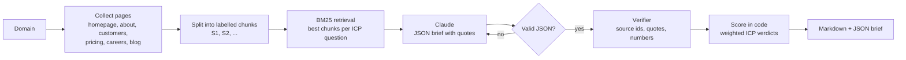

# Account Research Agent

Give it a company's domain and it returns a one-page account brief: what the company does, how well it fits your ideal customer profile (ICP), recent buying signals, who to contact, and a first-line opener. **Every ICP verdict, buying signal and opener must cite a quote from the pages the agent read, and every quote is checked word for word against its source before the brief is shown.** Claims that can't be verified are downgraded, removed or flagged.

Built by Noah Coker with Python, Claude, BM25 retrieval and Pydantic.

## Why

Account research is where reps lose hours: opening the website, the careers page, the blog, then guessing whether the company is worth a call. LLMs can do this in seconds, but they also make things up, and one invented "congrats on opening your Singapore office" in a cold email costs more trust than the research saved.

So the design goal was not "write a brief" but "write a brief a rep can trust without re-checking it".

## Example output

From [`examples/kestrel-freight_example.md`](examples/kestrel-freight_example.md) (a fictional company; the model reply is a real Claude Sonnet response, saved verbatim):

> **kestrel-freight.example** · Fit score **100/100 (Tier A)** · Evidence coverage **100%** · Grounding **15/15 quotes verified (100%)**
>
> **Buying signals**
> - **New Chief Revenue Officer.** A new revenue leader building a North American go-to-market team is likely to be choosing forecasting and pipeline tools. [S2] "Hannah Okafor, Chief Revenue Officer, joined in January 2026 to build out our go-to-market team in North America"
> - **Hiring a Revenue Operations Manager.** The role owns pipeline reporting and quarterly forecasting, which is the work revenue analytics software supports. [S5] "You will own our Salesforce instance, pipeline reporting and the quarterly forecasting process."
>
> **Suggested opener**
> Kestrel plans to double its go-to-market team in 2026, and its open Revenue Operations Manager role covers quarterly forecasting. We help RevOps teams forecast accurately and spot at-risk deals early as headcount scales.

## How it works



1. **Collect.** Fetches the homepage, then follows its links to the most useful pages (about, customers, pricing, careers, blog or press). It follows `robots.txt` (and stays out if robots.txt errors, per RFC 9309) and identifies itself with a clear user agent. Optional `--news` adds recent Google News headlines as extra sources.
2. **Retrieve.** Pages are split into overlapping chunks labelled `S1`, `S2` and so on, so every source can be traced back to a URL. Small sites that fit the 18-chunk budget go to the model whole. On larger sites, BM25 picks the best chunks for each ICP question and buying-signal query to keep the prompt small.
3. **Ask the model.** Claude gets only those labelled sources and strict rules: no outside knowledge, every claim needs a word-for-word quote under 25 words, and "unclear" when the sources don't say. The reply must match a Pydantic schema. If it doesn't, the model gets one chance to fix it.
4. **Verify.** Every quote must come from a real source id and appear in that source word for word. Only case, spacing, punctuation and quote marks may differ, so a changed word, number or currency fails. Any number in a signal, the opener, the summary or an ICP rationale (headcount, funding, number of open roles) must appear in a verified quote.
5. **Act on failures.** A "yes" or "no" without verified evidence becomes "unclear". A buying signal without verified evidence, or with an unsupported number, is removed. An opener without a verified quote is marked "needs review". An unsupported number in the summary or a rationale is flagged. Every action is listed in the brief.
6. **Score in code.** The fit score is a weighted sum of the verified verdicts (yes = full weight, unclear = 20%, no = 0), not a number the model makes up. Tiers: A is 75+, B is 55-74, C is below 55. **Evidence coverage** shows how much of the ICP weight was actually answered, so a low score from missing information looks different from a low score from a bad fit.

The ICP lives in [`icp.example.yaml`](icp.example.yaml): your offer, the questions with their weights, extra signal searches and target personas. Change it and the whole brief changes with it.

## Results

| Run | What it shows | Fit | Coverage | Quotes verified | Checks triggered |
|---|---|---|---|---|---|
| Kestrel Freight, a fictional funded freight-tech company ([brief](examples/kestrel-freight_example.md)) | Strong fit, rich website | 100 (A) | 100% | 15/15 | none |
| Bramble Studio, a fictional small design studio ([brief](examples/bramble-studio_example.md)) | Thin website: the model says "unclear" instead of guessing | 48 (C) | 35% | 6/6 | none |
| Kestrel reply with injected mistakes ([brief](examples/verifier-demo_kestrel-freight.md)) | A paraphrased quote, a made-up source id, an invented office and an inflated hiring number | 68 (B) | 60% | 11/14 | 2 verdicts downgraded, 2 signals removed, opener flagged |

The first two replies came from Claude Sonnet (`claude-sonnet-5-5`) on the saved pages in `tests/fixtures/`, and are stored verbatim in `examples/`. The third takes the first reply and injects the mistakes language models typically make, to prove the verifier catches each one:

```
- ICP 'growth': 'yes' had no verifiable evidence, changed to 'unclear'.
- ICP 'revops_stack': 'yes' had no verifiable evidence, changed to 'unclear'.
- Removed signal 'Opening a Singapore office': no verifiable evidence.
- Removed signal 'Hiring 10 SDRs': it states a number its quotes don't support.
- Opener is not backed by a verified quote; review before sending.
```

## Quick start

```bash
pip install -r requirements.txt
export ANTHROPIC_API_KEY=sk-ant-...

# One company
python -m account_research research acme.com --icp icp.example.yaml

# A list of companies (CSV with a "domain" column), ranked by fit
python -m account_research batch accounts.csv --icp icp.example.yaml --out results.csv
```

A single run writes a Markdown brief and the full JSON (every quote with its verification result) to `briefs/`. Batch mode writes the briefs to a folder named after `--out` (`results/` by default) plus a ranked CSV with fit score, tier, grounding rate, top signal and opener, ready to import into a CRM or sequencer. Your CSV needs a `domain` column, like [`examples/accounts.csv`](examples/accounts.csv).

Try it offline, with no API key, using the saved pages and model reply:

```bash
python -m account_research research kestrel-freight.example \
  --fixtures tests/fixtures --scripted examples/kestrel_model_reply.json

python examples/make_examples.py   # rebuilds all three example briefs, including the verifier demo
```

## Tests

36 tests, run on every push with GitHub Actions:

```bash
pip install -r requirements-dev.txt
pytest -q
```

They cover HTML cleaning, link discovery, robots.txt handling, news parsing, chunking and retrieval, quote matching (including altered words and numbers), number checks, every downgrade and removal rule, JSON repair, ICP validation, end-to-end runs on both fixture sites, and the batch CSV.

## Limitations

- The verifier checks quotes and numbers, not whether every sentence follows from its quote. Rationales, personas and first-call questions carry no quotes of their own. For example, the Kestrel summary says the company "has offices in Amsterdam, Lyon and Chicago". The sources only say its team is spread across those cities, the summary attached no quote for it, and the checks can't tell. A second-pass entailment check is the next step.
- Pages rendered entirely with JavaScript come back nearly empty. A headless browser fallback would fix that.
- With `--news`, quotes can come from Google News headlines rather than the company's own pages, and headlines alone keep news-based claims modest. News fetching is unit-tested on saved RSS, not against the live feed.
- It reads only public company pages and collects no personal data beyond the names of executives the company publishes itself.

## Repo layout

```
account_research/
  fetch.py      collect pages (robots.txt aware), optional news headlines
  extract.py    HTML to clean text and links
  retrieve.py   chunking and BM25 retrieval
  prompts.py    system and user prompts
  llm.py        Anthropic client, scripted client for tests, JSON parsing
  verify.py     quote, source and number checks; downgrade and removal rules
  pipeline.py   end-to-end run and scoring
  report.py     Markdown brief
  cli.py        research and batch commands
tests/          36 tests and two saved fixture websites
examples/       saved model replies, the briefs they produce, and the script that rebuilds them
```
